# Quire

**A desktop document reader for PDF, Markdown and images — with markup, real PDF editing, and marks that never touch your file.**

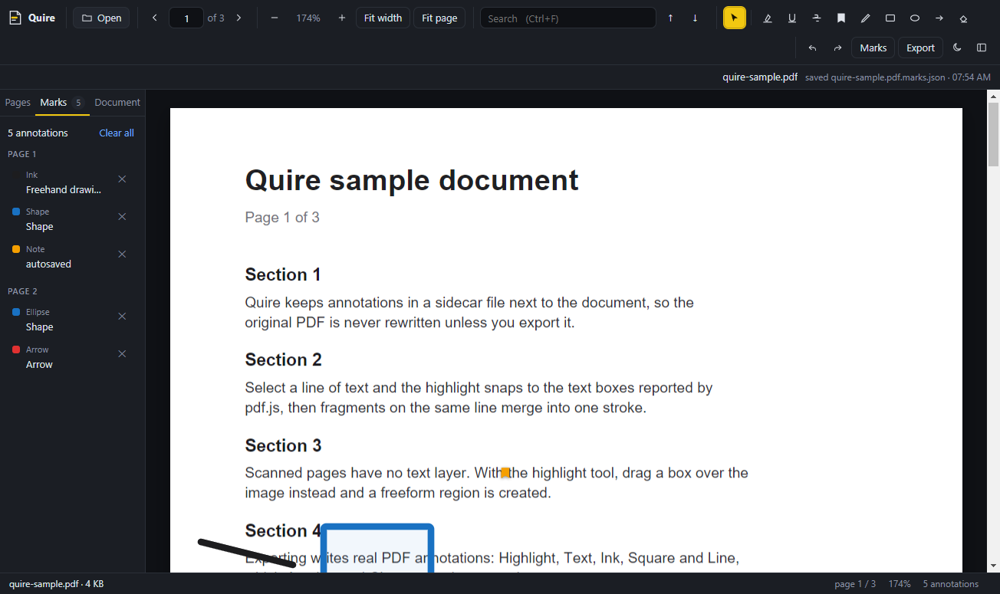

Quire is an Electron app that reads PDFs, Markdown (with KaTeX math) and images in document tabs. It highlights, underlines, annotates and draws on documents, edits PDF pages (reorder, delete, merge, resize, trim, stamp, find & replace, form fields), and exports annotated or flattened PDFs. Marks live in a JSON **sidecar** next to the file — the PDF's own bytes change only when you edit the document or export.

## Features

| | |
| --- | --- |
| **PDF reader** | Continuous scrolling pages, real text layer, zoom and fit modes, thumbnails, whole-document search. Pages render lazily. |
| **8 markup tools** | Highlight (snapped to text boxes), underline, strikethrough, note, ink, rectangle, ellipse, arrow — plus an eraser. Undo/redo, autosave. |
| **PDF editing** | Reorder, move, reverse, delete, duplicate, insert blank, merge, resize, trim margins, stamp, page numbers, find & replace, metadata, AcroForm fields. Marks follow their pages. |
| **Markdown + LaTeX** | GFM rendering through `marked`, sanitized HTML, KaTeX math (`$…$`, `$$…$$`), heading outline, a source editor that writes the file back. Marks are text anchors that survive edits. |
| **Image editor** | Crop with aspect ratios and exact pixel bounds, rotate, flip, brightness/contrast/saturation/blur, draw and text tools, B&W/sepia/invert, undo/redo, export to PNG/JPEG/WebP. |
| **Exports** | Annotated PDF (real `/Highlight`, `/Ink`, `/Text` objects), flattened PDF, print with paper/margin options, standalone HTML, marks-as-Markdown. |
| **Sessions** | Document tabs (`Ctrl+Tab` / `Ctrl+W`), recents, preferences (`Ctrl+,`), optional restore of tabs and reading positions. |

## Screenshots

### Welcome screen

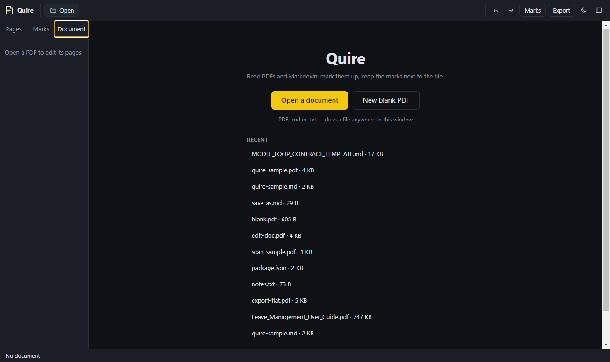

### Markdown with KaTeX

The same window renders Markdown as an article — tables, task lists, fenced code, and typeset math — with an outline, search and block-anchored marks.

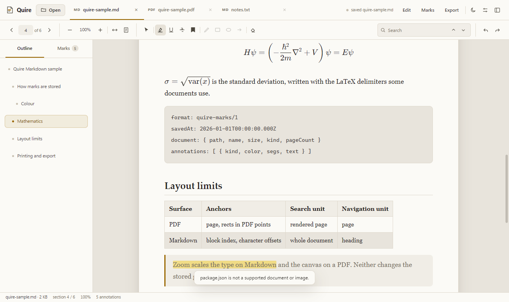

### Markdown source editor

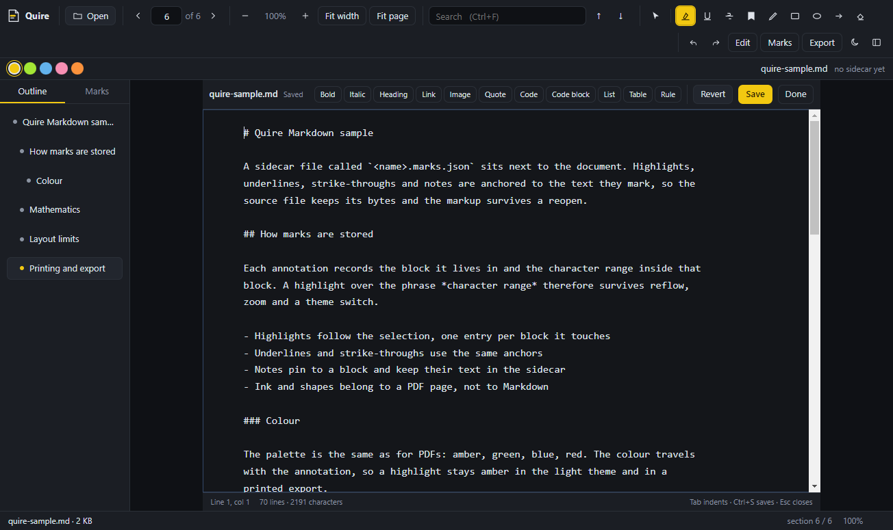

### Document tab — real PDF editing

Page list, resize, trim, stamp, numbering, merge, find & replace, metadata and form fields, in the sidebar's `Document` tab.

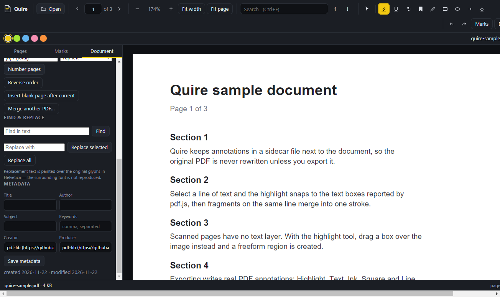

### Sidebar: pages and mark index

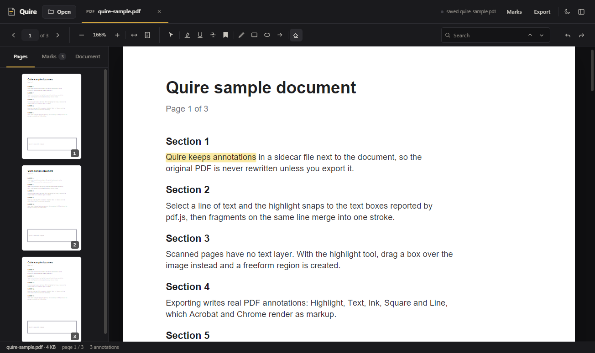

### Light theme, and scanned PDFs

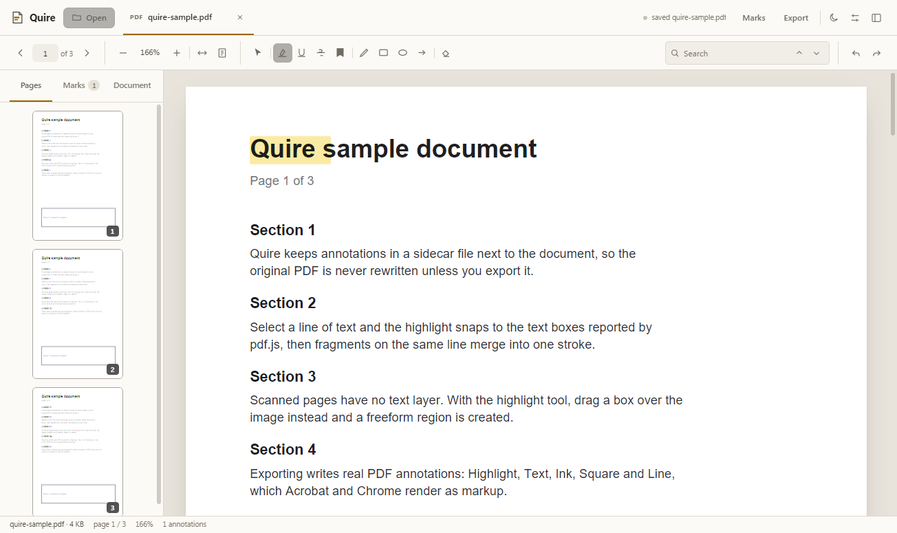

On a page with no text layer, the highlight tool drags a box instead — here on `samples/scan-sample.pdf`, an image-only page.

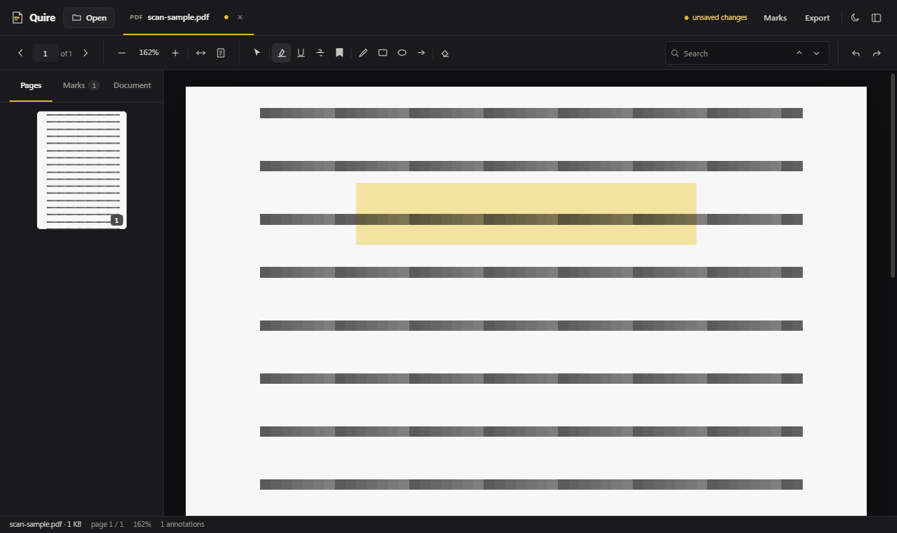

### Image editor

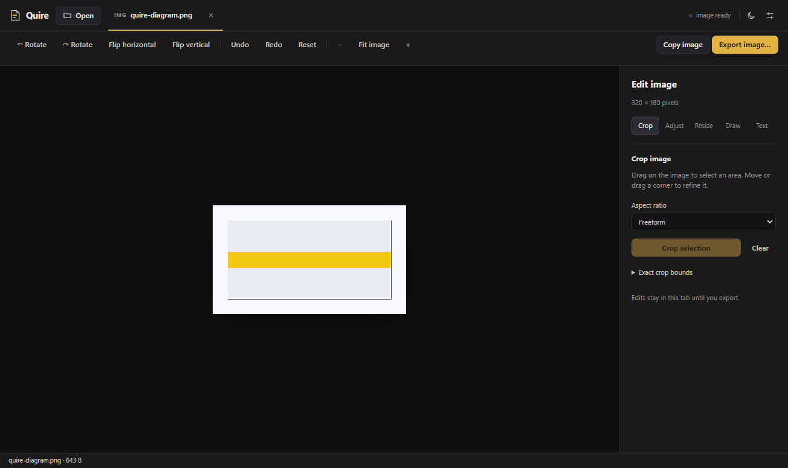 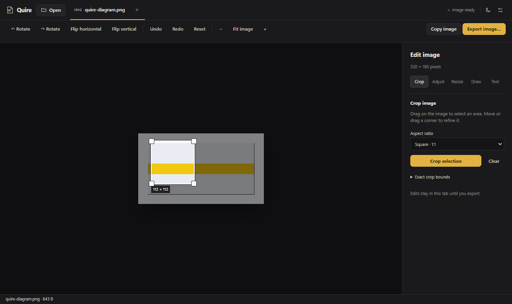

### Export menu, print dialog, preferences, shortcuts

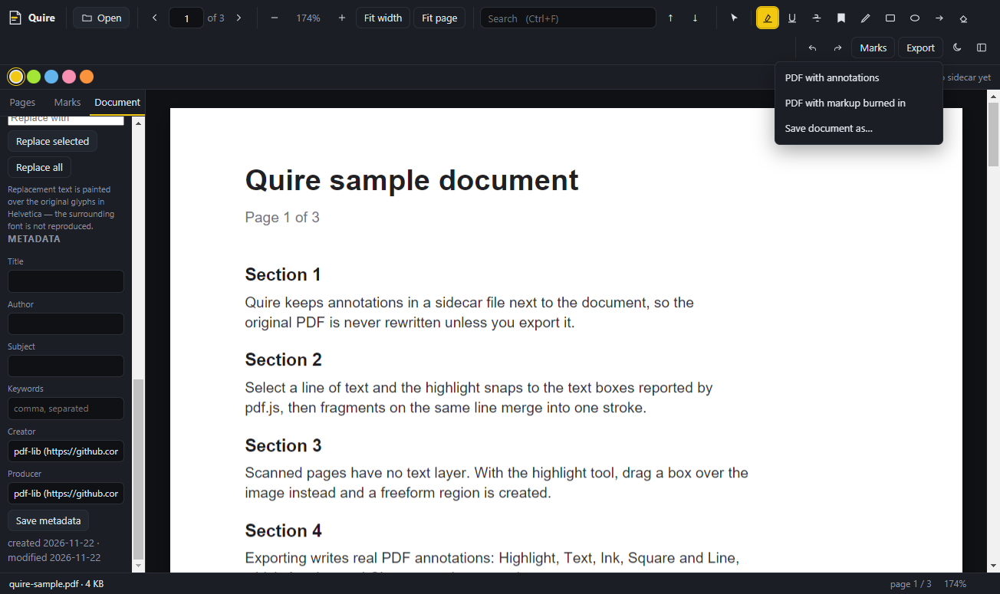 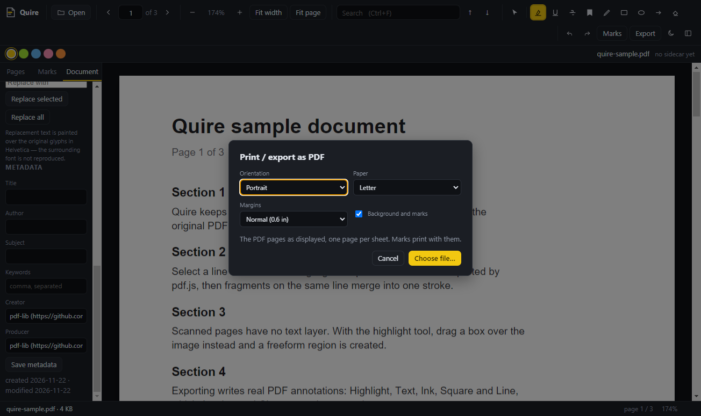 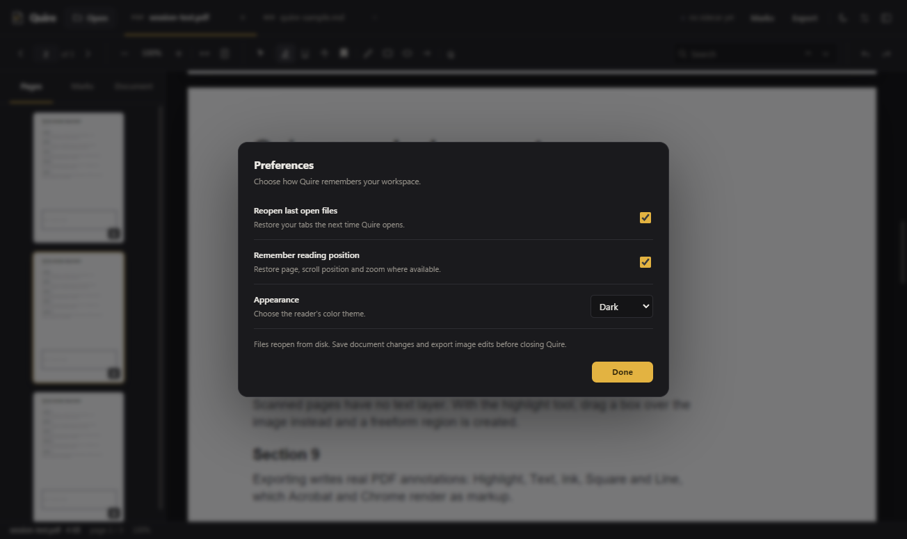 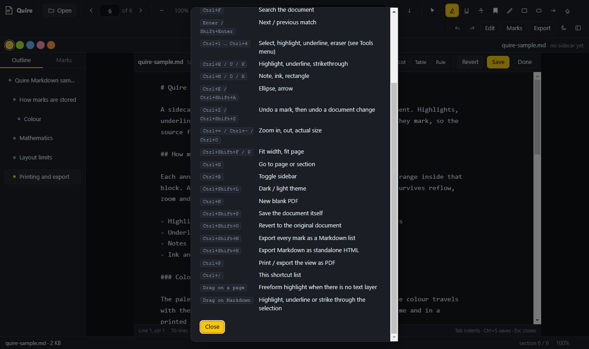

## Running

```
npm install
npx electron .       # window opens; use File > Open or drag in a document or image
npm run dev          # same, with devtools open
npm run sample       # writes samples/: two PDFs, a Markdown document with LaTeX, a PNG, notes.txt
npm run check        # syntax check every source file (ESM and CommonJS)
npm run test         # check, doc-edit and smoke, in one command
npm run doc-edit     # every page operation in src/doc-edit.js, in plain Node
npm run smoke        # export and server checks in plain Node, no window
npm run e2e          # drives the real window over the Chrome debug port
npm run e2e:chrome   # cold start, theme, sidebar, help, print rules, recents
npm run e2e:interactions  # 45 human steps across every tool, search, zoom, export, themes
npm run e2e:markdown      # Markdown + KaTeX rendering, outline, search, anchors, rendered export
npm run e2e:edit          # page operations, marks that follow them, print options, Markdown source editing
npm run e2e:tabs          # multi-document tab switching and restoration
npm run e2e:image         # image editing and export
npm run e2e:session       # preferences and workspace restore across restarts
npm run shots        # screenshots + layout assertions for the panels and dialogs (test/out/ux-*.png)
npm run build        # unpacked build/Quire-win32-x64/Quire.exe
npm run dist         # unsigned unless signing credentials are configured; installer and ZIP
npm run dist:release # requires code signing; installer and ZIP
npm run dist:portable # explicitly build the portable target
npm run verify:exe   # drive the unpacked exe
npm run verify:portable   # test the actual portable executable, if available
npm run launch:time -- <exe>   # spawn to first page painted
```

`npm run e2e` needs a display and puppeteer. It looks for puppeteer in `$PUPPETEER_PATH`, then `node_modules`, then `npm root -g`. It generates the sample PDFs if they are missing.

## Building an exe

Run `npm run build` for an unpacked app, or `npm run dist` for the installer and ZIP using the locally installed Electron. The default build may be unsigned. For distribution, configure a trusted Windows code-signing certificate with electron-builder and run `npm run dist:release`; this fails if signing cannot be performed. Do not put certificate passwords or private keys in this repository.

The portable self-extractor has been quarantined by Avast on this machine. It is not built by default, and the build does not move or retry quarantined artifacts — preserve the alert details and submit the detected sample to Avast for review. `npm run dist:portable` builds it only when explicitly requested. Use `node test/verify-exe.js --exe <path>` to test a specific packaged executable.

## Markup

| Tool | Result |
| --- | --- |
| Highlight | Rectangles snapped to text boxes, colour from the swatch row |
| Underline, Strikethrough | One stroke per line, fragments on the same line merged |
| Note | Pin on the page, text in a popup editor |
| Ink | Freehand stroke, weight 1 to 8 pt (PDF only) |
| Rectangle | Outline box (PDF only) |
| Ellipse | Oval fitted to the drag box, same weight control (PDF only) |
| Arrow | Straight stroke with an open arrow head (PDF only) |
| Eraser | Deletes the object under the cursor |

Select text and press the highlight tool to mark it. On a page with no text layer, the same tool drags a box instead.

Undo and redo walk the annotation list. `Ctrl+S` forces a save, otherwise the sidecar is written 900 ms after the last change, and closing the window flushes unsaved marks synchronously before the renderer goes away.

## Editing a PDF

The sidebar's `Document` tab works on the file rather than on the marks. It sends structured operations to `src/doc-edit.js`, which runs pdf-lib in the main process, and the renderer reloads the surface from the returned bytes.

| Operation | What it does |
| --- | --- |
| Order, move, reverse | The page field takes `1,3-4`, `even`, `odd`, `all` or a list |
| Delete, duplicate | Duplicates get no provenance, so they arrive without the original's marks |
| Insert blank | Joins the size of the page it follows, not a fixed A4 |
| Merge | Another PDF, whole or by page range, spliced in after the current page |
| Resize | Preset (A3 to tabloid), exact width and height, landscape, or `fit` which keeps the aspect ratio and centres the content |
| Trim margins | Measures each page's text, images, paths and annotations, then crops the media and crop boxes to that box |
| Stamp, page numbers | Helvetica at any of nine positions; `{n}` and `{total}` expand in the number format |
| Find & replace | Hits come from pdf.js's text layer; a replacement paints a cover rectangle over the old glyphs and writes the new word in Helvetica |
| Metadata | Title, author, subject, keywords |
| Form fields | Text, checkbox and list fields read from the AcroForm, filled, cleared, flattened; XFA removed |

Marks follow their page. `applyOps` returns a provenance map — new page index back to the page it came from — and `remapMarks` moves each mark to the first page carrying its original page. A mark whose page is deleted goes with it, and comes back with `Ctrl+Z` along with the page.

`Ctrl+Shift+S` writes the staged bytes over the file (`Ctrl+Shift+S` on Markdown saves the source text). `Ctrl+Shift+O` puts back the file as it sits on disk; marks are kept. `Ctrl+N`, and the New PDF button on the welcome screen, start a blank one-pager you can stamp, number and merge into.

## Markdown and LaTeX

A file is a document of one of two kinds, decided from its bytes before its name: `%PDF-` at the offset 0 means PDF, a NUL byte means binary and is refused with a toast, otherwise an extension in `.md .markdown .mdown .mdwn .mkd .mkdn .mdx .txt .text` means Markdown. `package.json` is refused, `notes.txt` is read as Markdown.

`marked` renders CommonMark plus GFM — tables, task lists, fenced code, strikethrough — and the HTML goes through a sanitizer: `script`, `style`, `iframe`, `on*` handlers and `javascript:` targets are stripped, and only a fixed attribute list survives. Math is lifted out of the source first, so `marked` never mangles it, and typeset back through KaTeX. Both libraries are served from `node_modules` over the local server, so nothing is bundled by hand.

Headings become the outline; `Ctrl+PageDown`/`Ctrl+PageUp` and `Ctrl+G` move between sections. Zoom scales the article's type instead of a bitmap, so reflow happens at any size.

Marks on Markdown are anchors, not rectangles: a highlight stores `{ block, start, end }`, the character range inside one top-level block, and is repainted as a `<span>` over that range. The `Edit` button opens a source editor over the article; marks survive the edit because `reanchor()` re-finds each mark's text in the new blocks after every save.

Export writes the rendered article to PDF through Electron's `printToPDF` (`Ctrl+Shift+X`), and **Standalone HTML** (`Ctrl+Shift+H`) produces the article with its stylesheet inlined and local images embedded as data URLs.

## Printing and other exports

`Ctrl+P` opens a print dialog instead of firing the OS print: orientation, paper (`Letter`, `Legal`, `A4`, `A5`, `B5`, `JIS-B4`, `JIS-B5`), margins (`none`, `minimal`, `normal`) and whether to print backgrounds. It exports through `printToPDF`, so the same dialog produces a PDF or hands the job to a printer. Toolbar, sidebar and editor chrome are hidden by the `@media print` rules.

The export menu also holds **Marks as Markdown** (`Ctrl+Shift+M`): one section per mark, grouped by kind, with the quoted text, its page or section, colour, and note text.

## Sidecar file

`<document-name>.marks.json`, written beside the document — the extension stays in the name, so `report.pdf.marks.json` and `report.md.marks.json` are different files. If that folder is not writable the file goes to `<userData>/marks/<name>.json` instead.

```json
{
  "format": "quire-marks/1",
  "savedAt": "2025-01-14T10:31:02.412Z",
  "document": { "path": "…/quire-sample.pdf", "name": "quire-sample.pdf", "size": 4364, "pageCount": 3 },
  "annotations": [
    { "id": "a7f3c1", "page": 1, "kind": "highlight", "color": "#f2c811",
      "rects": [{ "x": 56, "y": 140.54, "w": 113.69, "h": 12.32 }], "text": "Quire keeps annotations" }
  ]
}
```

Kinds: `highlight`, `underline`, `strikeout`, `rect` and `ellipse` carry `rects`; `ink` and `arrow` carry `points`; `note` carries `x`, `y` and `text`. Geometry is stored in PDF points measured from the top-left of the page, so zoom and window size never change a mark; the overlay SVG's viewBox equals the page size in points. A corrupt entry is dropped on load rather than crashing the paint.

## Export

Two modes, both leaving the source file alone:

- **Annotations** (`Ctrl+Shift+E`) writes real PDF objects: `/Highlight` with `QuadPoints`, `/Text` with `Contents`, `/Ink` with `InkPoints`, `/Square`, `/Circle`, and `/Line` with an open head for arrows. Acrobat, Chrome and Preview show these as markup.
- **Flattened** (`Ctrl+Shift+B`) draws the markup into the page content stream. Viewers that ignore annotations still show it, and the result survives being emailed around with no sidecar.

Exporting twice into the same file appends a second set of annotation objects rather than replacing the first. Export to a new name.

## Layout

```
src/main.js            window, menu, IPC, recent list (12 entries), sidecar read/write, kind detection, print-to-PDF
src/server.js          localhost static server: renderer/, pdfjs-dist, /vendor/marked, /vendor/katex, /local?path=
src/export-pdf.js      pdf-lib export, both modes
src/doc-edit.js        page operations on the PDF itself: order, delete, merge, resize, crop, stamp, metadata, form fields
renderer/preload.js    the only bridge the page can reach (window.api)
renderer/js/viewer.js       pdf.js rendering, text layer, zoom, thumbnails, text search, content measurement
renderer/js/markdown.js     marked + KaTeX article, outline, block anchors, search surface, HTML export, re-anchoring
renderer/js/annotations.js  annotation state, tools, pointer handling, SVG painting
renderer/js/search.js       document-wide search
renderer/js/sidebar.js      page thumbnails, the mark index, and the Document tab
renderer/js/docpanel.js     the Document tab: page list, resize, trim, stamp, numbering, merge, find & replace, metadata, forms
renderer/js/edit.js         Markdown source editor: toolbar, dirty state, idle save, revert
renderer/js/app.js          toolbar, shortcuts, autosave, export, note editor, document operations
tools/make-icon.js    generates assets/quire.ico
tools/build.js        @electron/packager run
tools/dist.js         electron-builder run, with a writable portable artifact name
tools/inspect-build.js  lists what went into resources/app.asar
tools/launch-time.js  spawn to first page painted, for any exe
docs/screenshots/     the images in this README, captured by npm run shots and the e2e tests
```

The renderer is served over `http://127.0.0.1:<port>` rather than `file://` because pdf.js runs its parser as an ES-module worker, and module workers do not load from a `file://` origin. The server binds loopback only, resolves paths inside two roots (`renderer/` and `node_modules/pdfjs-dist`), and refuses anything that escapes them; the page CSP allows only `'self'`. Node integration is off in the renderer, so `window.api` is the whole attack surface.

Pages render lazily: an IntersectionObserver with a 400 px margin starts a render when a page approaches the viewport and cancels it when it leaves.

## Keyboard

| Key | Action |
| --- | --- |
| `Ctrl+O` / `Ctrl+W` | Open / close document |
| `Ctrl+Tab` | Switch document tab |
| `Ctrl+S` | Save marks to the sidecar |
| `Ctrl+Shift+E` / `Ctrl+Shift+B` | Export annotations / flattened (PDF sources) |
| `Ctrl+Shift+X` | Export the rendered Markdown article as PDF |
| `Ctrl+F`, `Enter`, `Shift+Enter` | Search, next hit, previous hit |
| `Ctrl+1` … `Ctrl+4` | Select, highlight, underline, eraser |
| `Ctrl+H` `Ctrl+U` `Ctrl+K` `Ctrl+M` `Ctrl+D` `Ctrl+R` | Highlight, underline, strikethrough, note, ink, rectangle |
| `Ctrl+E` / `Ctrl+Shift+A` | Ellipse / arrow |
| `Ctrl+Z` / `Ctrl+Shift+Z` | Undo a mark, then a document change / redo a mark |
| `Ctrl+=` `Ctrl+-` `Ctrl+0` | Zoom in, out, 100% |
| `Ctrl+Shift+F` / `Ctrl+Shift+P` | Fit width / fit page; on Markdown these set the article width and type scale |
| `Ctrl+PageDown` / `Ctrl+PageUp` | Next / previous page, or section on Markdown |
| `Ctrl+G` | Go to page, or to section on Markdown |
| `Ctrl+B` | Sidebar |
| `Ctrl+Shift+L` | Theme |
| `Ctrl+N` | New blank PDF |
| `Ctrl+Shift+S` / `Ctrl+Shift+O` | Save the document itself / revert to the file on disk |
| `Ctrl+Shift+H` / `Ctrl+Shift+M` | Standalone HTML / marks as a Markdown list |
| `Ctrl+P` | Print, with paper and margin options, chrome hidden |
| `Ctrl+,` | Preferences |
| `Ctrl+/` | Shortcut list |

`Ctrl` means `Cmd` on macOS.

## Tests

`npm run test` runs `check` (syntax-checks every `.js` under `src/`, `renderer/js/`, `test/` and `tools/`), `doc-edit` (every page operation in `src/doc-edit.js` without a window, finished over `samples/quire-sample.pdf`) and `smoke` (an 8-mark set exported both modes, reloaded with pdf-lib and asserted; server traversal refused).

The e2e suite launches Electron with `--remote-debugging-port` and drives the live window over puppeteer: `e2e` (marks, search, zoom, sidecar, both exports, undo), `e2e:chrome` (welcome screen, recents, theme, print rules), `e2e:interactions` (45 human steps across every tool), `e2e:markdown` (rendering, KaTeX, outline, anchors, export), `e2e:edit` (page operations with marks following, find & replace, forms, Markdown editing), `e2e:tabs`, `e2e:image`, `e2e:session`. `npm run shots` screenshots the panels and dialogs and asserts layout; images land in `test/out/` — the ones in this README are copies of those.

Packaged binaries can be tested with `node test/verify-exe.js --exe <path>`.

## Limits

- Markup written by other apps is not read in. Quire only draws its own marks, and the sidecar is the source of truth.
- Search joins text items with a space; matching is case-insensitive, no regex or whole-word option.
- Form fields render as static appearance in the viewer; filling happens in the Document tab.
- Find & replace paints a cover rectangle over the old glyphs and writes the replacement in Helvetica — the original glyphs stay in the content stream.
- Trim skips rotated pages instead of cropping them wrong.
- Saving a document rewrites it through pdf-lib, so bytes are not identical to the original even when nothing was moved.
- A document operation is undoable but not redoable; redo only walks the mark list.
- A password-protected PDF fails to open with a toast; there is no password prompt.
- GIF images are edited as a single frame; animation is not preserved. Export the image before closing its tab to keep changes.
- The builds register no file association and no updater. The portable exe pays its extraction on every launch.
- Markdown source editing writes the file as it stands — no diff, no merge.
- `.tex` files are not LaTeX documents. Math only appears inside Markdown, in the four delimiters KaTeX is wired for.
