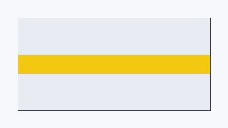

# Quire Markdown sample

A sidecar file called `<name>.marks.json` sits next to the document. Highlights,
underlines, strike-throughs and notes are anchored to the text they mark, so the
source file keeps its bytes and the markup survives a reopen.

## How marks are stored

Each annotation records the block it lives in and the character range inside that
block. A highlight over the phrase *character range* therefore survives reflow,
zoom and a theme switch.

- Highlights follow the selection, one entry per block it touches
- Underlines and strike-throughs use the same anchors
- Notes pin to a block and keep their text in the sidecar
- Ink and shapes belong to a PDF page, not to Markdown

### Colour

The palette is the same as for PDFs: amber, green, blue, red. The colour travels
with the annotation, so a highlight stays amber in the light theme and in a
printed export.

## Mathematics

Inline maths rides inside a sentence: the sidecar is compact because only offsets
are stored, so the payload for a highlight over $E = mc^2$ is a handful of bytes.

Display maths gets its own line:

$$
\int_0^{\infty} e^{-x^2}\,dx = \frac{\sqrt{\pi}}{2}
$$

\[
H\psi = \left(-\frac{\hbar^2}{2m}\nabla^2 + V\right)\psi = E\psi
\]

\(\sigma = \sqrt{\operatorname{var}(x)}\) is the standard deviation, written with
the LaTeX delimiters some documents use.

~~~text
format: quire-marks/1
savedAt: 2026-01-01T00:00:00.000Z
document: { path, name, size, kind, pageCount }
annotations: [ { kind, color, segs, text } ]
~~~

## Layout limits

| Surface | Anchors | Search unit | Navigation unit |
| --- | --- | --- | --- |
| PDF | page, rects in PDF points | rendered page | page |
| Markdown | block index, character offsets | whole document | heading |

> Zoom scales the type on Markdown and the canvas on a PDF. Neither changes the
> stored geometry of a mark.

Links to the wider web open outside the app, links to a sibling file open inside
it: [the README](../README.md).

---

## Printing and export

Printing the rendered document is handled by Electron's print pipeline, which is
why the exported PDF looks like the screen rather than the source bytes.
